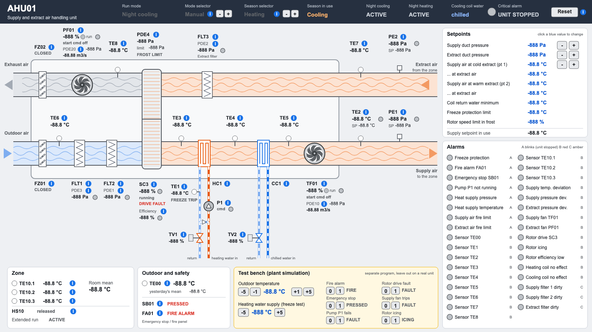
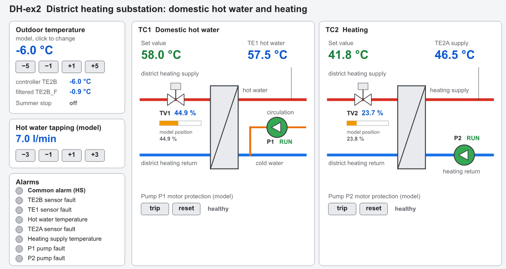

# ebo-workstation: a Claude skill for Schneider EcoStruxure Building Operation

Lets an AI coding agent (Claude Code) program EBO 7.1 for you: you describe the plant, the agent writes the
Function Block program, loads it into the Enterprise Server through WorkStation, compiles it, binds it, draws an
operator graphic and can publish values over MQTT. It works the real WorkStation through its user interface, the
same dialogs you would click.

What is in the skill:

- `reference/findings.md`: how WorkStation and the Function Block editor behave when driven from outside, the
  `.aut` program text format with its traps, bindings, graphics (TGML), MQTT.
- `scripts/ebo.sh` + `scripts/win/`: the driver. PowerShell that works WorkStation by UI Automation.
- `scripts/aut.py`: Function Block program generator with automatic layout and wire routing.
- `scripts/tgml.py`: graphic (HMI) generator. `scripts/fuxa.py`: FUXA project generator for an MQTT view.
- `examples/dh-ex2/`: a worked example, a district heating substation (Finnish Energy K1/2013, example
  connection 2) with controller, plant model, operator graphic and MQTT view.
- `examples/ahu01/`: a larger worked example, a generic air handling unit: controller with one PID per heating /
  cooling stage in 20 hierarchical blocks and 33 alarms, plant simulation, animated operator graphic with info
  boxes, weekly schedules, trend logs and dashboard, the same program prepared in an MP-C controller, MQTT and a
  FUXA view. `deploy.sh` there loads the lot. How it runs: `examples/ahu01/README.md`.





## What you need

Everything on one Windows machine, your laptop is fine:

- EcoStruxure Building Operation 7.1.1, Enterprise Server and WorkStation, **with a valid licence**. A test
  installation, never a production server: the driver creates and deletes objects under `/Server 1`.
- Claude Code for Windows (it brings Git Bash, which runs `ebo.sh`).
- Python 3.
- For the MQTT part only: Mosquitto on `127.0.0.1:1883`, and FUXA (`npm install -g @frangoteam/fuxa`) on
  `http://127.0.0.1:1881/` if you want the web view.

## Install

In Git Bash:

```bash
git clone https://github.com/Maxxis20/ebo-workstation-skill ~/.claude/skills/ebo-workstation
cd ~/.claude/skills/ebo-workstation
```

That is all you must do by hand. Start Claude Code and say what you want, for example "check that the EBO skill
is ready on this machine" or straight away "build a Function Block program in EBO for an air handling unit
with ...". The agent runs a check first, sets up what it can, and asks you for the rest:

- **the WorkStation password**, in a Windows box on your screen (not in the chat);
- **Classic Mode**, once: open any Function Block program in WorkStation and switch `Show Classic Mode` on;
- anything missing on the machine (Python, a stopped Enterprise Server service).

It also fetches the Function Block editor's block catalogue from your own installation. That is Schneider's file,
so it is not in this repository, and the program generator needs it.

## By hand, if you want to see it work first

```bash
E=~/.claude/skills/ebo-workstation/scripts/ebo.sh
$E check                                                    # what is ready, what is not
$E setup                                                    # work folder, block catalogue
$E logon                                                    # starts WorkStation, asks for the password
$E shot now.png                                             # a screenshot of your desktop
$E run "Ws-LoggedOn"                                        # True when WorkStation is logged on
$E put examples/blink.aut 'C:\agentwork\ebo\blink.aut'
$E run "Fb-Load '/Server 1' 'Blink' 'C:\agentwork\ebo\blink.aut'" 150
```

**Hands off the keyboard and mouse while a command runs.** The driver brings WorkStation to the front, types and
clicks. After about 40 seconds `/Server 1/Blink` exists, compiled and running.

**Password.** WorkStation logs off after 5 idle minutes, so the agent has to log on again now and then. It runs
`ebo.sh logon`, and a Windows credential box opens on your screen: type the WorkStation password there. It goes
straight to the log-on form; the agent does not see it. Do not paste the password into the chat. For unattended
use there is `EBO_SECRET_RUN="op run --"` with a secret manager, or `EBO_ADMIN_PASSWORD` in the environment.

**Screen.** No fixed resolution is needed: the driver finds buttons by name. Some clicks are placed a few pixels
from an element it found, measured at 100 % display scaling, so set scaling to 100 % if clicks land beside their
target. Very small screens (1024x768) do not fit the editor.

## Limits, plainly

- Worked out and tested on one installation only: EBO 7.1.1.132, English, screen 1600x1200 at 100 % scaling. Not
  yet tried on a range of laptops, and `ebo.sh` itself has not been run under Git Bash (the PowerShell side it
  calls has). Other display scaling, EBO versions or languages will break some of it. The findings say where each fact came from, so the agent can often work out a
  fix. Tell me what broke: issues are welcome.
- WorkStation is driven through UI Automation names and menu command ids where it offers them, and through a few
  fixed screen positions where it does not.
- The WorkStation automation API would be the proper way in. It needs an SDK licence key, and this skill does
  not work around that.
- One command at a time, and nobody else on the keyboard while it runs.
- WebStation in the Brave browser: clicks on a graphic do nothing until "Block fingerprinting" is switched off
  for that site (lion icon > Advanced options). Not a fault of the graphic; details in the findings.
- Slow where the user interface is slow: about 10 s per MQTT data point, about 6 s per bound point.
- The engineering is still yours: check what the agent built before it goes anywhere near a real plant.

## Not affiliated

An independent project, not made, endorsed or supported by Schneider Electric. EcoStruxure, Building Operation
and Menta are trademarks of Schneider Electric. No Schneider software or files are included; you need your own
licensed installation.

MIT licence.
