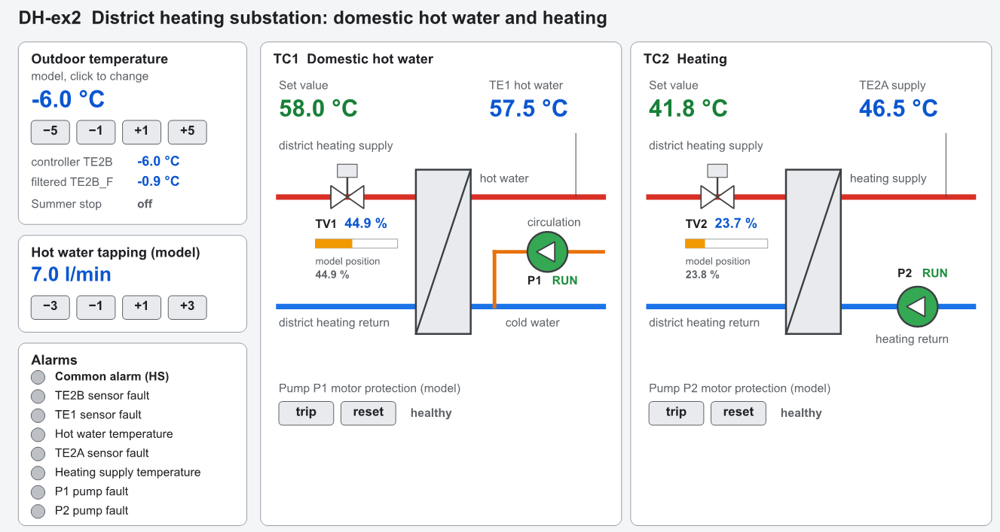
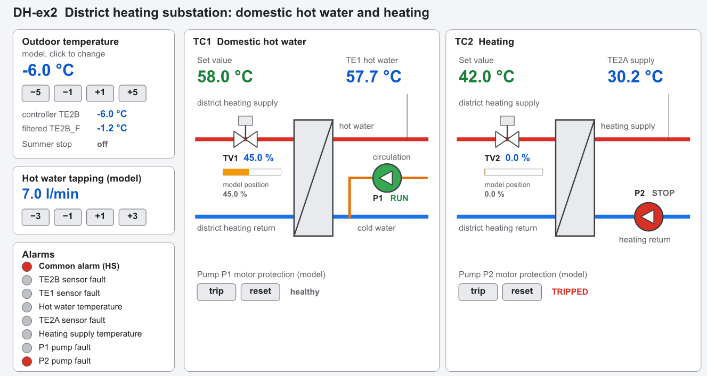

# DH-ex2: district heating substation, worked example

Domestic hot water and heating, one control valve and one pump each, after example connection 2 of Finnish
Energy's publication K1/2013 (District heating of buildings, regulations and guidelines). An AI agent wrote the
first version with this skill from `DESCRIPTION.md` alone, in 18 minutes 39 seconds. Afterwards, on the
engineer's review: pumps drawn where the K1 drawing has them, and pump fault alarms added.



| File | What |
|---|---|
| `make_program.py` → `DH-ex2.aut` | The controller: 62 function blocks, 76 wires, modules OUTDOOR, TC1_DHW, TC2_HEAT, ALARM |
| `make_sim.py` → `DH-ex2-SIM.aut` | A small plant model (18 blocks) so the loops have something to control |
| `make_hmi.py` → `DH-ex2-HMI.tgml` | Operator graphic, 113 elements, 27 bound points, buttons to step the outdoor temperature and to trip a pump |
| `make_fuxa.py` → `DH-ex2.fuxa.json` | FUXA view of the main values over MQTT |
| `points.py` | Bindings between the three objects and the MQTT point list |

## What it does

- **TC1, hot water**: TV1 keeps TE1 at the set value. P1 is the circulation pump.
- **TC2, heating**: TV2 keeps the supply temperature TE2A on a curve from the outdoor temperature. P2 is the
  network pump on the return. Summer stop by outdoor temperature.
- **Alarms** (HS): sensor faults, temperature limits, and pump faults from the motor protection.
  - P1 fault: alarm only. Hot water still flows through the exchanger when someone opens a tap, so TV1 keeps
    controlling.
  - P2 fault: alarm, and TV2 closes to 0 %. Without flow on the heating side an open valve would only send
    district heat back unused.



## Load it

Set-up from the main README done, `E` = `scripts/ebo.sh`, run from this folder:

```bash
python3 make_program.py && python3 make_sim.py && python3 make_hmi.py
$E logon
$E put DH-ex2.aut 'C:\agentwork\ebo\DH-ex2.aut'; $E put DH-ex2-SIM.aut 'C:\agentwork\ebo\DH-ex2-SIM.aut'
$E run "Fb-Load '/Server 1' 'DH-ex2' 'C:\agentwork\ebo\DH-ex2.aut'; Fb-Load '/Server 1' 'DH-ex2-SIM' 'C:\agentwork\ebo\DH-ex2-SIM.aut'" 300
$E run "$(python3 points.py bind-prog)" 300
$E put DH-ex2-HMI.tgml 'C:\agentwork\ebo\DH-ex2-HMI.tgml'
$E run "Gfx-Load '/Server 1' 'DH-ex2-HMI' 'C:\\agentwork\\ebo\\DH-ex2-HMI.tgml'" 200
$E run "$(python3 points.py bind-hmi)" 500
$E run "Ws-Open '/Server 1/DH-ex2-HMI'" 60; $E shot hmi.png
# MQTT and FUXA, if Mosquitto and FUXA run on the same machine:
$E run "$(python3 points.py mqtt)" 560
python3 make_fuxa.py && $E fuxa DH-ex2.fuxa.json
```

The `.aut` and `.tgml` files can also be imported by hand: Function Block editor `File > Import...`, Graphics
Editor source view.

## Checked and not checked

Checked on a running server: both programs compile and run, the loops settle at plausible values, the graphic
shows live values, an outdoor temperature step made on the graphic reaches the controller, and both pump faults
behave as described above (pump red, alarm, TV2 to 0 % for P2 only, recovery after reset).

Not checked: sensor faults, temperature limit alarms, summer stop. They are in the program; nobody has exercised
them. The plant model is a teaching model, not calibrated. An example to learn from, not a design to commission.

`DESCRIPTION.md` was written for an Ouman Ouflex version of the same example and is kept as the agent got it.
File names it mentions (`plan.json`, `make_plan.py`, `layout.json`, `examples/dh2`) belong to that project and
are not here, and it does not yet describe the pump faults.
