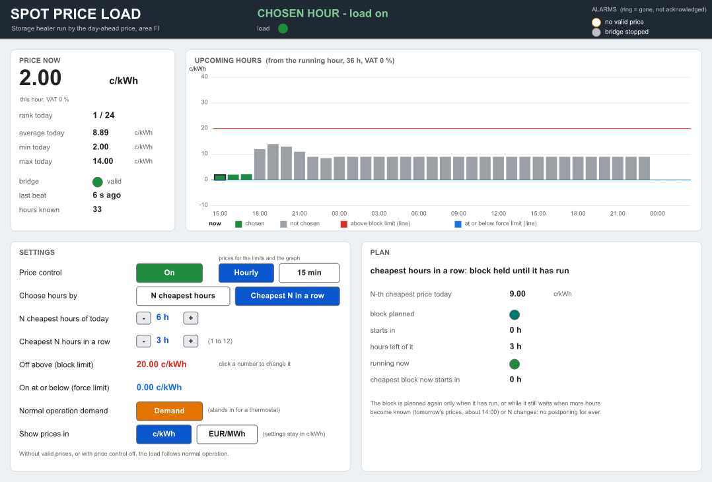

# Spot price load for EBO

A load (a storage heater, say) run by the day-ahead electricity price: the price now, a graph of the upcoming
hours, and settings to use them, among them "the cheapest N hours in a row". The prices come from a small spot
price bridge over MQTT; the bridge, which fetches day-ahead prices for the Nordic and Baltic bidding zones and
serves them as MQTT and Modbus TCP, is a separate program (not part of this example). Everything here is
generated from Python and loaded into EcoStruxure Building Operation 7.1 by script (skill `ebo-workstation`).

## What it ran on

An EBO 7.1.1.132 **Enterprise Server only**, with WorkStation, the MQTT broker (Mosquitto) and the bridge
(Python 3.12 with `tzdata`, fake source) on the same Windows machine; no controller, no I/O. The load is the
program's output `Load_Cmd` only, and "normal operation" (what the load does without prices: a thermostat, a time
schedule) is the server value `Set/Normal_Demand`.

## Not tested

- **A real controller or field device**: the program runs on the Enterprise Server; the load (`Load_Cmd`) drives
  nothing, and "normal operation" (`Normal_Demand`) is a server value set by hand or by the tests. Both are
  simulated.
- **EBO connected to a live bridge**: the tests use the bridge's fake source on the EBO machine. The live bridge
  was run (as a container, `bridge-container/`) and fetched real prices, but no EBO server read them through a
  broker it could reach.
- **A whole day in real time**: time was moved by the fake source's clock, a few hours per test; no run lasted
  through the afternoon publication of tomorrow's prices or across midnight on the real clock.
- **The clock change** (23 or 25 hour day): the bridge has rules for it (CONTRACT), the example was not run on one.

## How the prices come in

The bridge publishes, every 10 s and retained, a topic `spot/<AREA>/points`: one JSON list of
`{"id": "spot.<key>", "v": <number>}` with everything (price now, rank, valid, beat, today's 24 hours and ranks,
the upcoming 48 hours and 96 quarters, where the cheapest block of N hours starts for N = 1..12). An EBO MQTT client reads one
JSON pointer pair per client, but with `JsonPtrCommandRoot` set to the list it takes every item of it: **one
client, client `Prices`, fills all 219 values** in folder `Spot`, each found by its Foreign address (`spot.now`,
`spot.u0` ...).

**The area is chosen in one place**: the client's subscription topic (`spot/FI/points`; `make_objects.py --area
SE3`, or change `SubscriptionTopic` of `SpotPrice_IoT/Prices` in WorkStation).

## How it decides

Setting `Mode` picks how hours are chosen:

| Mode | Chosen hours |
|---|---|
| 0 N cheapest hours | the N cheapest hours of today (`rank <= N_Cheap`) |
| 1 cheapest N in a row | the cheapest block of `N_Block` consecutive hours (1..12) among the upcoming known hours |

Over both: at or below `Force_Below` the load runs (cheap or negative price), above `Block_Above` it does not.
`Ctl_On` = 0 switches price control off.

`Res` chooses hourly or 15 minute prices for the limit checks and the graph (36 hours, or 36 quarters = 9 hours).
The choice of hours stays hourly: the bridge ranks hours, and ranking 96 quarters is not practical in a Function
Block program. `Unit_MWh` shows the prices in EUR/MWh instead of c/kWh (1 c/kWh = 10 EUR/MWh); inside, and in the
settings, c/kWh. All prices are without VAT, as the bridge serves them ("VAT 0 %" on the graphic).

**The block is held.** The bridge says in how many hours the cheapest block starts now (`spot.blk<N>`). A
plan made again every hour could postpone the load for ever (the cheapest block keeps sliding ahead), so the
program takes it once and counts it down with the clock (`Plan_Wait` hours to the start, then `Plan_Left` hours
of running). It plans again only when the block has run, or, while still waiting, when at least two more hours
become known (tomorrow's prices in the afternoon) or N changes. Once the block runs, it runs to its end.

**No price**: `valid` = 0 from the bridge, or its `beat` (one step every 10 s) standing still for 60 s, gives
`No_Price`: price control steps aside, the load follows normal operation, and an alarm says why
(`Alarms/Price_Invalid`, `Alarms/Bridge_Stopped`; only while price control is on).

`Reason` (header of the graphic): 0 price control off, 1 chosen hour, 2 not chosen, 3 above the block limit,
4 at or below the force limit, 5 no price data.

## The graphic

Header: why the load is on or off, the load lamp, the two alarms. Left: the price now, rank, today's average /
min / max, bridge state (valid, seconds since the last beat, hours known). Middle: the upcoming 36 hours as bars
from the running hour (outlined), hour of day below; green chosen, grey not chosen, red above the block limit,
blue at or below the force limit (the two limits also as lines). Header lamps of the alarms: amber active,
a ring = gone but not acknowledged. Bottom: the settings (numbers open the change dialog
when clicked) and the plan.

## Files

| File | What |
|---|---|
| `make_program.py` -> `Spot.aut`, `io.json` | the program (modules Inputs, Prices, Block, Ctl, Plan, Alarms, Hmi; 360 blocks) |
| `make_hmi.py` -> `SpotPrice.tgml`, `hmi_binds.json` | the graphic |
| `make_objects.py` -> `SpotPrice-values.xml`, `SpotPrice-iot.xml`, `binds.json` | folders Spot (the bridge's values, Foreign addresses `spot.*`) and Set (settings); MQTT clients `Prices` (the bridge) and `Test` (settings in, trace out); every binding |
| `add_foreign.py` | puts the Foreign addresses back after the bind round trip (a Special export drops them) |
| `deploy.sh` | all of it onto a server, bound: about 8 minutes |
| `make_fake.py` -> `fake/*.json` | price days for the bridge's fake source, one file per test step (each sets the bridge's clock) |
| `bridge-container/` | the bridge as a container beside an EBO server container (compose: broker on loopback + bridge) |
| `run_tests.sh`, `spottest.ps1`, `analyze.py` | the test scenarios: bridge started on the EBO machine, settings by MQTT, trace by MQTT, screenshots, timelines |
| `test-out/` | timelines and screenshots of the last run (results: `TESTS.md`) |

## On a server

`./deploy.sh ['/Server 1'] [SpotPrice] [FI]`, then a bridge publishing to the same broker. Open
`SpotPrice/Graphic`; alarms in `SpotPrice/AlarmList`. Tests: `./run_tests.sh [out dir] [t1 ... t6]`.
